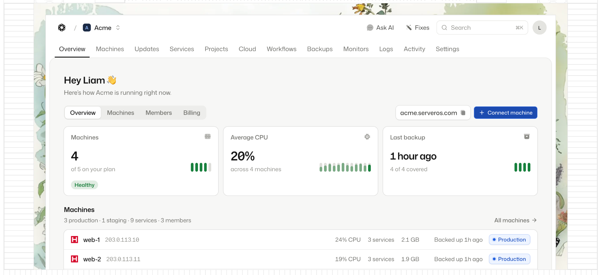

  <a href="https://serveros.com">
    <picture>
      <source media="(prefers-color-scheme: dark)" srcset=".github/assets/logo-dark-mode.svg">
      
    </picture>
  </a>

<h1 align="center">ServerOS panel</h1>

One place to run the Linux servers you already own.

  
  
  
  
  

  

The open source panel behind [ServerOS](https://serveros.com): one place to run the Linux servers you already own. Connect a VPS with one command, then deploy apps, sites and databases, keep an eye on them, back them up and fix them, without living in a terminal.

The panel talks to [serverosd](https://github.com/serveroshq/daemon), the small daemon that runs on each of your machines.

## Status

We're moving the panel's code into this repo now. Until it lands, this repo holds the license, the contributing rules and the security policy. Watch the repo (Watch → Custom → Releases) to hear when the first release is out.

## What's here and what isn't

| | Where | License |
| --- | --- | --- |
| The panel | This repo | [AGPL-3.0](LICENSE), free to self-host |
| The daemon | [serveroshq/daemon](https://github.com/serveroshq/daemon) | [AGPL-3.0](https://github.com/serveroshq/daemon/blob/main/LICENSE), free to self-host |
| Paid features | A separate private repo | Commercial, unlocked with a license key |
| ServerOS Cloud | [serveros.com](https://serveros.com) | A hosted service, not part of this repo |

[LICENSING.md](LICENSING.md) explains what that means for you.

## Getting help

- Docs: [docs.serveros.com](https://docs.serveros.com)
- Questions and ideas: [Discussions](https://github.com/serveroshq/panel/discussions)
- Chat: [Discord](https://discord.gg/serveros)
- Bugs: [Issues](https://github.com/serveroshq/panel/issues/new/choose)

Found a security problem? Please don't open an issue. Follow [SECURITY.md](SECURITY.md) instead.

## Contributing

Read [CONTRIBUTING.md](CONTRIBUTING.md) first. Everyone who takes part agrees to the [Code of Conduct](CODE_OF_CONDUCT.md), and first-time contributors sign our [CLA](CLA.md) in a comment on their pull request.

## License

The panel is licensed under the [GNU Affero General Public License v3.0](LICENSE). Copyright © 2026 ServerOS Cloud Ltd.

The ServerOS name and logo are trademarks of ServerOS Cloud Ltd and aren't covered by the AGPL. See [TRADEMARKS.md](TRADEMARKS.md).
